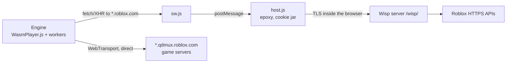

# webblox-built

Roblox's official browser client (binary type `WebClientApp`, an Emscripten
build) running on your own server, already built. Drop it into your site or
run it as-is.

Roblox's engine files are **not** in this repo. `bun run fetch:webblox` pulls
them straight from Roblox's CDN.

> Prefer having your agent build it from scratch? See
> [x8rr/webblox](https://github.com/x8rr/webblox).

## Quick start

Needs [Bun](https://bun.sh) and Node 18+ (for the fetch script).

```sh
bun install
bun run fetch:webblox   # ~255 MB into vendor/webblox/engine/
bun start               # http://127.0.0.1:8080/blox/
```

`PORT` and `HOST` change where it listens. The page must be served over HTTPS
(or from `localhost`) for service workers and `SharedArrayBuffer`.

Open `/blox/` for a small launcher (search, or paste a game link), or go
straight to a game with `/blox/?placeId=<id>` (`&gameInstanceId=<job id>` for
one server of it). Joining needs a signed-in Roblox session; see
[Signing in](#signing-in).

## How it works



- `/blox/` is served **cross-origin isolated** (COOP `same-origin` + COEP
  `require-corp`): the engine runs on pthreads over a shared
  `WebAssembly.Memory`. It must be a top-level page in its own tab or window,
  never an iframe inside a page without COEP.
- Every HTTP request the engine makes to Roblox (from the page or its
  workers) is caught by `sw.js` and handed to the page. `host.js` sends it
  over Wisp with [epoxy](https://github.com/MercuryWorkshop/epoxy-transport),
  which terminates TLS in the browser, so the Wisp server never sees the
  session. Cookies live in a jar in `localStorage`.
- Game traffic is WebTransport straight to `*.qdmux.roblox.com`, not through
  Wisp.
- Join quirks handled in `host.js`: `gamejoin` is called with
  `rbx-user-agent: Roblox/Darwin` and the `*.qdmux.roblox.com` name is derived
  from the join response when Roblox leaves `gameFqdn` out; other requests get
  a native client user agent; `?gameInstanceId=` turns `/v1/join-game` into
  `/v1/join-game-instance`.
- The engine's feature flags are pinned next to it
  (`engine/PinnedFlags.json`, written by the fetch script) so a later Roblox
  flag push cannot break an older engine.

## Files

| Path | Role |
|---|---|
| `webblox/index.html`, `host.css` | Host page. Every DOM id in it is looked up by `WasmPlayer.js`; keep them. |
| `webblox/host.js` | Relay (sw → epoxy → Wisp), cookie jar, session, launcher, engine boot. |
| `webblox/sw.js` | Service worker scoped to `/blox/` that hands cross-origin requests to the page. |
| `server/blox.ts` | `createBloxHandler(paths)`: serves `/blox/*` with the isolation headers, sends the gzip copy of `WebClient.wasm`, falls back to Roblox's CDN for engine files missing on disk. |
| `server.ts` | Standalone server: `/blox/` plus a Wisp server at `/wisp/` limited to Roblox hosts on port 443. |
| `scripts/fetch-webblox.mjs` | Downloads the engine from `setup.rbxcdn.com` (resumable, size-checked). |

## Engine

```sh
bun run fetch:webblox                            # current production version
bun run fetch:webblox version-f807b21caba84809   # a specific upload
```

It resolves the version from
`clientsettings.roblox.com/v2/client-version/WebClientApp`, downloads
`WasmPlayer.js`, `WebClient.js`, `WebClient.wasm` (~100 MB),
`WebClient.metadata.json`, `audio-processor-fast.js` and the ~2900 content
files the metadata lists, gzips `WebClient.wasm`, and pins the live flags.
Files already on disk with the right size are skipped, so an interrupted run
resumes. A new version replaces the old one. Rerun it to update.

## Embedding in your own server

1. Copy `webblox/`, `server/blox.ts` and `scripts/fetch-webblox.mjs`, and add
   `@mercuryworkshop/epoxy-transport` (3.x) as a dependency.
2. Mount the handler (Bun):

   ```ts
   import { BLOX_PREFIX, createBloxHandler } from "./server/blox";

   const handleBlox = createBloxHandler({
     host: "webblox",
     engine: "vendor/webblox/engine",
     epoxy: Bun.resolveSync("@mercuryworkshop/epoxy-transport", import.meta.dir),
   });

   // in your fetch handler
   if (pathname.startsWith(BLOX_PREFIX)) return handleBlox(req, pathname);
   ```

   Not on Bun? The handler is ~130 lines of Request/Response; swap `Bun.file`
   for your runtime's file API. Whatever serves it must keep the
   COOP/COEP/CORP headers.
3. Give the page a Wisp server. It uses `/wisp/` on its own host unless
   opened with `?wisp=wss://…`, which it then remembers. If you run your own,
   restrict it to Roblox like `server.ts` does, or it is an open proxy.
   Roblox rate-limits per IP, and the IP it sees is the Wisp server's.
4. Open `/blox/?placeId=…` in a new tab or popup, never an iframe.


## Signing in

Joining needs a `.ROBLOSECURITY` session (without one Roblox answers 524 "Not
authorized"). Sign in to roblox.com in Chrome on a computer, copy the cookie
from DevTools (Application → Cookies → roblox.com), and paste it into the
sign-in prompt. It stays in that browser's `localStorage` and is only sent to
Roblox, over TLS that ends in the browser.

Using a modified client carries a small risk of an account warning from
Roblox. Test on an alt.

## Tests

```sh
bun test
bun run typecheck
```

## Credits

- Roblox's `WebClientApp` engine belongs to Roblox and is downloaded from
  their CDN, not distributed here.
- [epoxy-transport](https://github.com/MercuryWorkshop/epoxy-transport) and
  [wisp-js](https://github.com/MercuryWorkshop/wisp-js) by MercuryWorkshop.

## Deploying

Needs a host that runs a long-lived process with WebSockets and HTTPS. Static
hosts (GitHub Pages, Netlify, Vercel) cannot run the Wisp server.

**Fly.io**

```sh
fly launch --copy-config --no-deploy   # pick a unique app name
fly volumes create webblox_vendor --size 1
fly deploy
```

First boot downloads the engine (~255 MB, a minute or two) before the server
listens. Update later with `fly secrets set WEBBLOX_UPDATE=1 && fly deploy`,
then unset it. Pin a version with `WEBBLOX_VERSION=version-…`.

**VPS (Docker + Caddy, auto HTTPS)**

```sh
DOMAIN=play.example.com docker compose -f deploy/docker-compose.yml up -d --build
```

Open `https://<your-domain>/blox/`.

## Run it on GitHub (Codespaces, free)

On the repo page: **Code → Codespaces → Create codespace on main**. When it
opens, the server starts on port 8080 by itself and the engine downloads in the
background (`/tmp/webblox-fetch.log`; `/tmp/webblox-server.log` for the server).
In the **Ports** tab make 8080 **Public** if it isn't already, then open its
URL. The codespace stops when idle; starting it again restarts the server.
